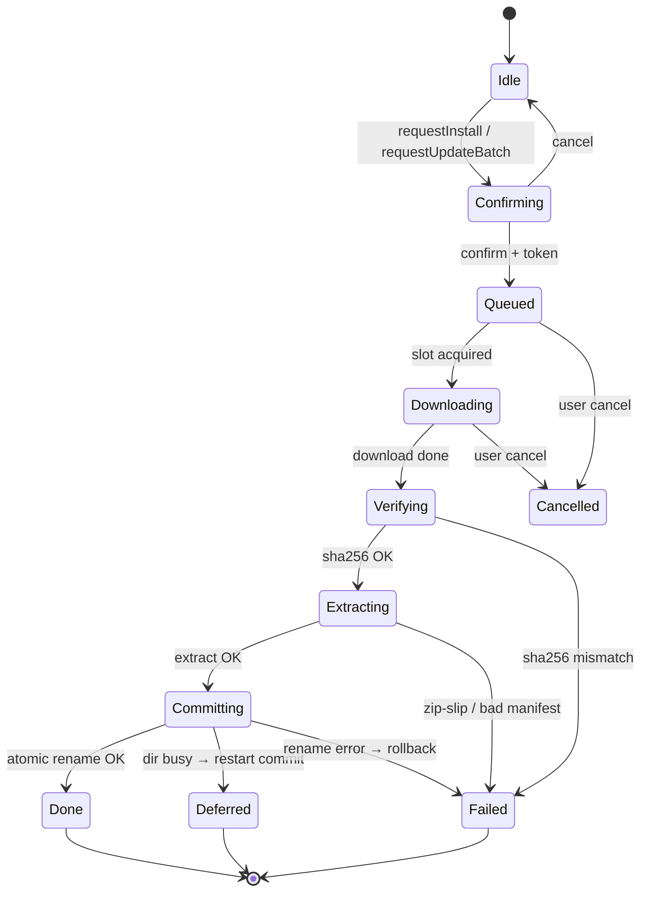

# 插件安装/更新确认 —— 壳托管与批量更新 · 待决策提案

> **状态：待决策**（2026-11-24 立案；用户当场指方向：确认 UI 收归壳、批量一次、修 Update 误跳详情）。
> **一句话**：把「每次更新弹一张确认卡」改成「**新装必问、同源更新批量一问、风险变更必问**」，并把确认 UI 与执行权收归壳——**任何市场想装/更新插件，都必须走壳的确认 API；原始安装 API 不再能被静默调用**。
> **原型**：[01-原型.html](./01-原型.html)（可点，含全部场景、状态与逻辑说明；直接双击浏览器打开）。
> **关联**：[插件权限系统](../插件权限系统/00-提案.md)（长期权限面，别在本档重复）、[插件更新须重启](../插件更新须重启.md)（重启语义）。

---

## 〇、决策区（请先拍板）

| # | 决策 | 选项 | 我的建议 |
|:--|:--|:--|:--|
| **D1** | 确认 UI 归谁 | A 市场自绘（现状）／B 壳托管、壳绘制／C 壳托管＋市场只能追加「纯文本说明」 | **C**：UI 与安全语义归壳，市场只提供结构化数据（名称/版本/来源/发布者/changelog 链接），⛔ 不传 HTML/CSS |
| **D2** | 怎么让「必须调 API」真的成立 | A 只写契约要求市场调用（可绕过，不成立）／B **原始 `pluginManager.install/update` 收为内部，改为一次性确认令牌**／C 保留原始 API 只记警告（过渡） | **B**：壳的确认流程发放一次性 token（绑定 pluginId + version + source + sha256 + 过期时间），没有 token 的 install/update 一律拒绝 |
| **D3** | 同源更新还逐项弹吗 | A 每次弹（现状）／B **同源更新不逐项弹；批量只弹一张汇总卡**／C 完全静默（连首装也不问） | **B**；C 不建议（等于把安装信任一次性全交出去） |
| **D4** | 批量怎么跑 | A 逐项 `await`＋每项确认（现状）／B **一张汇总确认 → 全部入队 → 壳的 3 并发槽执行 → 统一进度/汇总** | **B**：3 是下载/解压并发，不是条数上限 |
| **D5** | 「以后不再问」的开关放哪 | A 不放／B **壳级「按来源信任」：更新免问，首装仍问，来源/发布者变更自动失效**／C 全局「永不问」 | **B**；C 只能作为显式高风险选项，不建议默认 |
| **D6** | 市场自己（core）要不要进 Update all | A **不进批量，单更＋重启提示**／B 进批量 | **A**：自更新要重启，混在批量里会打断队列 |
| **D7** | 落地顺序 | A **P0 市场侧：批量一张卡＋修误跳＋不跳详情；P1 壳托管＋HTTPS/sha256/来源身份**／B 一次到位（壳不发版，周期长） | **A**：先把体感修好，同时把真安全排进 P1 |

> 🔴 **D2 是关键**：只要求市场「调用新 API」而不关闭原始安装通道，等于没做——任何插件仍然能直接调壳 API 静默安装。必须让**壳的原始安装/更新入口本身**变成「无确认令牌不可执行」。

---

## 一、问题与现状

### 1.1 用户实机痛点（2026-11-24）

1. **每次更新都要点一次确认**：`Update all` 存在，但实际是「N 个插件 = N 张确认卡」，点着点着就烦；
2. **体感有「一次只能更新 3 个」的上限**；
3. **点 Update 偶尔跳到详情页**，尤其在列表滚到最顶、首行卡片 hover 展开时；
4. **更新完不想再看到那个「更新页面/详情页」**——更新就更新，用户想进去看再自己点。

### 1.2 代码现状（读代码定位）

| 位置 | 现状 |
|:--|:--|
| `marketplace/src/services/installGate.ts` | **恒弹确认卡**；官方不豁免、来源不记忆；富卡走 `dialog.confirmContent`，缺面回落纯文字 confirm，再缺面返回 `false`（问不了就不装） |
| `marketplace/src/services/marketUpdateAction.ts` | 单项更新序列：在线防御 → 下载址 → `minAppVersion` 门 → **确认卡** → `pluginManager.update` |
| `marketplace/src/services/libraryActions.ts` | `updateAll` 是**串行 `await`**，逐个 `performMarketUpdate` ⇒ 逐个弹卡；`!r.core` 排除内置件 |
| `src/pluginLoader/lifecycle/install-queue/types.ts` | `INSTALL_CONCURRENCY = 3`——**下载/解压并发槽**，注释写明「先按 3 做、可校准、首批实机后由用户拍板」 |
| `src/pluginLoader/lifecycle/update.ts` | stage → unload → 原子 commit → 账本 → 重载；失败回滚/启动补提交；**无签名、无 checksum** |
| `src/core/services/plugins/IpcBridgeHandler/pluginManager.ts` | `install`/`update` 是**任何插件都能调的 IPC 面**——这是「市场确认门可被绕过」的根 |

### 1.3 历史复盘：为什么当年「每次都问」、为什么有 3

- **E6#71k（2026-09-10）**：用户先指出「装 7 个插件就是点 14 次按钮」，AI 提「每个来源第一次确认」并获同意；**当天用户改口**：「暂时都问吧……这个作为一个更新点，等未来版本专门研究安全问题，先不在这个地方纠结了」⇒ 信任表 `installTrust.ts` 整套删除，改成恒弹。**这是临时停损，不是终态。**
- **「3」的来历**：18 档 §八⑦c「先按 3 做」；同时实测「连点 7 个确认卡只能装上 0～1 个」——**确认卡不能排队**。所以「一次只能几个」的体感，主要来自确认卡阻塞，不是批量条数限制。
- **诚实边界**（`installGate.ts` 原话）：确认门只在市场 UI 层，不是安全机制；已装插件可绕开它直接调壳 API；全仓零签名/零 checksum。

---

## 二、目标与非目标

**目标**
1. 新装永远有一次明确的「来源/发布者/版本」确认；
2. 同源更新不再逐项打断；批量更新一次确认、连续执行、可见进度；
3. 点击 Update 不再跳详情页；更新完成也不自动开详情；
4. 把确认 UI 与执行权收归壳，任何市场都必须走同一条安全通道；
5. 为真正的安全（HTTPS、sha256、来源身份）留出壳侧落点。

**非目标**
- 插件权限系统/沙箱/签名（见 [插件权限系统](../插件权限系统/00-提案.md)，本档只引用，不重复设计）；
- 重做商店视觉/卡片布局；
- 自动更新的策略大改（只补「官方源优先」边界）。

---

## 三、架构：壳托管确认（D1 + D2）

### 3.1 为什么「市场必须调 API」本身不够

现在的 `pluginManager.install/update` 是公开 IPC 面。一个恶意/偷懒的市场可以完全跳过自己的确认 UI，直接调壳 API。**只加一个「新 API」而不收回旧通道 = 新 API 只是建议。**

⇒ 正确形态：**壳把「确认」变成执行的前置条件**，而不是市场的一个可选 UI。

### 3.2 目标 API（壳面）

```ts
// 壳暴露：所有市场（官方/第三方）共用；UI 由壳绘制
interface PluginInstallRequest {
  mode: "install" | "update";
  pluginId: string;
  version: string;
  downloadUrl: string;
  sha256?: string;              // P1 起必填（目录已收录的版本）
  source: {                     // 来源身份（壳记录/比对）
    id: string;                 // 市场源 id / official
    url: string;                // 目录源 URL
    repo?: string;              // GitHub repo（若可判定）
    publisher?: string;         // 作者/发布者
  };
  display: {                    // 只允许结构化纯数据，⛔ HTML
    name: string;
    icon?: string;
    description?: string;       // 纯文本，截断
    changelogUrl?: string;
    size?: number;
  };
}

interface PluginInstallResult {
  confirmed: boolean;
  cancelled?: boolean;
  jobId?: string;               // 确认后壳已入队；进度走 plugin:installJobs
  reason?: "user-cancelled" | "source-changed" | "integrity-failed" | "min-app" | "no-token";
}

// 唯一入口：确认 + 执行（壳内部同一事务）
linkdesk.plugins.requestInstall(req: PluginInstallRequest): Promise<PluginInstallResult>;

// 批量：一张汇总确认 → 逐项入队
linkdesk.plugins.requestUpdateBatch(reqs: PluginInstallRequest[]): Promise<{ confirmed: boolean; jobIds: string[] }>;
```

**原始通道的处理（D2）**
- `pluginManager.install/update` 改为**内部/受保护**：必须携带 `confirmationToken`（壳在确认流程里签发，一次性、绑定 `pluginId+version+source+sha256+expiresAt`）；
- 没有 token ⇒ 拒绝并记录 `install:rejected no-token`；
- 旧市场/旧插件在过渡期：新壳返回明确错误码 + 文档；**壳未发版，正好一次切换**；
- 第三方市场：调同一个 `requestInstall` 即可，能力不受限（壳 UI 统一，市场仍可自定义浏览面）。

### 3.3 壳绘制的确认卡（D1）

**壳拥有**：标题/按钮/焦点锁/Esc/遮罩/来源与发布者/版本/大小/风险徽标/哈希校验状态/「首次安装」「来源变更」「降级」等风险文案。
**市场只能给**：结构化 `display`（名称、图标、纯文本简介、changelog 链接、大小）。
**主题**：壳读当前主题 token（暗/亮/玻璃都成立），⛔ 不由市场传 CSS；需要品牌色时只接受一个 `accent` 色值并做对比度校验。

### 3.4 来源身份与信任（D5）

壳在安装账本里记录：`pluginId / sourceId / sourceUrl / repo / publisher / version / sha256 / installedAt`。

- **首次安装**：无论来源，必弹确认；
- **同源更新**（sourceUrl + repo + publisher + pluginId 全同、HTTPS、版本↑、sha256 命中）：按设置决定是否逐项确认；
- **来源/发布者变更**：按「新装」确认，卡片明确展示 `旧源 → 新源`；
- **降级/选旧版**：确认；
- **完整性失败 / id 不符 / minApp 不满足**：直接拒绝，不弹。

### 3.5 设置（D5）

建议壳级设置 `plugins.updateConfirm`：

| 值 | 行为 |
|:--|:--|
| `always` | 每次更新都确认（现状，保守） |
| `official-silent`（建议默认） | **官方目录同源更新不逐项确认**；第三方源同源更新仍按源确认；首装始终确认 |
| `trusted-silent` | 用户显式信任过的来源，其同源更新不确认；首装仍确认；来源/发布者变更自动失效并要求重新确认 |

> 用户说的「以后从插件市场下载都不需要点确认」= `trusted-silent` 对某个来源的效果；**首装不建议静默**——那等于把第一次信任决定也省掉。

---

## 四、确认策略矩阵（最终版）

| 动作 | 确认？ | 形态 |
|:--|:--:|:--|
| 新装插件（任何来源） | **是** | 壳富卡（来源/发布者/版本/大小/哈希） |
| 同源更新（官方，`official-silent`） | **否** | 直接入队，行内进度 + 完成 toast |
| 同源更新（第三方，按源信任） | **按设置** | 首次按源一次；信任后免问 |
| 批量 Update all | **一张汇总卡** | 列出 N 个、旧→新、来源、风险标记 |
| 来源/仓库/发布者变更 | **是** | 「来源变更」卡（旧→新） |
| 降级/选旧版 | **是** | 确认卡（已有语义） |
| minAppVersion 不满足 | **否（直接拦）** | 错误提示，不进入确认 |
| 哈希/ID/zip-slip 失败 | **否（直接拒）** | 错误 + 清理暂存 |
| 自动更新（opt-in） | **否** | 结束后汇总通知；默认只对官方源开 |
| 内置 core（市场自身） | **单更** | 单项确认（若策略要求）→ 更新 → 重启提示；不进批量 |

---

## 五、批量更新（D4）

1. 点 `Update all` ⇒ 壳 `requestUpdateBatch` 生成**一张汇总卡**（N 个、旧→新、来源、大小、风险标记）；
2. 用户确认 ⇒ 全部 `requestInstall` 入队（壳的 3 并发槽；其余排队）；
3. 进度：通知面板每行「排队 / 下载 / 解压 / 替换 / 完成 / 失败」，卡片按钮同步；支持取消排队/在跑项；
4. 完成：一条汇总 toast「已更新 N 个，失败 M 个（查看）」；失败行保留 [重试]；
5. **不逐项弹卡、不自动开详情页、不串行等确认**；
6. `Update all` 不包含 core（市场自身）；市场自身单更后提示重启。

> 3 并发是 I/O 预算（下载/解压），不是条数上限；批量可以有 10 个，3 个在跑、7 个排队。是否把 3 调到 5，等首批实机由用户按体感定（沿用 `INSTALL_CONCURRENCY` 注释的校准约定）。

---

## 六、Update 按钮误跳详情页（P0 必修）

### 6.1 根因

`CardGrid` 的展开面用 `useStickyClearance` 算吸顶避让量 `--x-shift`：
- `onPointerEnter` 量一次（此时 `0fr → 1fr` 动画刚开始，`scrollHeight` 可能还是 0/半截）；
- 按钮获得焦点（mousedown）时 `onFocus` **再量一次**（此时展开已生效，按完整高度算）⇒ `--x-shift` 变大，整个展开面（含 Update 按钮）向下跳，最多 `HOVER_MAX_SHIFT = 80px`；
- 鼠标没动，按钮从指针下跑掉；mouseup 落在卡片本体 ⇒ 触发整卡 `onClick` = 打开详情页。`ActionButton` 的 `stopPropagation` 只在「按钮是事件目标」时有效，目标已变成卡片，拦不住；
- 对话框抢焦点触发 `onBlur` 复位，还会再跳一次。

### 6.2 修法（几何契约，不是调数值）

1. **hover 会话内冻结几何**：`pointerenter` 时按「完全展开」的确定性高度算一次 `--x-shift`，之后 `focus/blur` 不再重算；
2. **只在指针不在卡内时响应键盘 focus**；`onBlur` 不因对话框抢焦点而复位，**`pointerleave` 才复位**；
3. **测量确定性**：展开高度不读动画中的 `scrollHeight`——用隐藏测量/固定内容高度/一次强制展开测量，保证两拍同值；
4. **防御性抑制**：动作区 `pointerdown` 记「刚点过动作」，短时间内卡片 `open` 不响应（双保险）；
5. **回归**：`hoverShift` 纯函数单测 + 模拟 rect 的 hook 测试（focus 前后 `--x-shift` 不变）+ 真机顶行步骤。

### 6.3 验收

滚到最顶 → hover 首行卡 → 点 Update：**按钮不动**、确认卡/进度正常；取消后卡片不位移；只有点卡片空白才进详情；更新完成不自动开详情。

---

## 七、安全硬化（P1，命根子）

> 弹窗只负责「让你知道装的是什么」，不负责「拦住坏东西」。真正的安全必须在壳。

| 项 | 现状 | P1 目标 |
|:--|:--|:--|
| 传输 | `http(s)` 都允许 | **远程强制 HTTPS**；http 源拒绝（磁盘路径除外） |
| 内容完整性 | 无 checksum | 目录 `versions[]` 增 `sha256`；壳下载后**先校验再解压/commit**；不符 → 删除暂存 + 拒绝 |
| 来源身份 | 只记 `user/marketplace` | 账本记录 `sourceUrl/repo/publisher`；变更 → 重新确认 |
| 降级 | `allowOlder` 显式放行 | 保留 + 确认卡明示 |
| 原子替换 | 已有 stage/commit/回滚 | 保留；P1 不动 |
| 自动更新 | opt-in | 默认仅官方源；第三方源需显式打开 |
| 签名/权限 | 无 | 长期：接 [插件权限系统](../插件权限系统/00-提案.md)；签名另立 |

**迁移**：旧目录条目没有 `sha256` ⇒ 过渡期「未校验」徽标 + 不阻断；官方目录回填后，新版本强制校验。`sha256` 由 publish 计算，SDK/kit schema 同步。

---

## 八、接口与状态机



**事件**：沿用 `plugin:installJobs` 全量快照（壳侧唯一生产），市场只读渲染；`requestInstall` 返回 `jobId`，进度/终态从 job 表读。

**token 形状（D2）**

```ts
interface InstallConfirmationToken {
  token: string;          // 一次性 nonce（壳签名/内存表）
  pluginId: string;
  version: string;
  sourceUrl: string;
  sha256?: string;
  expiresAt: number;      // 60s
  used: boolean;
}
```

壳在 `requestInstall` 内完成「画卡 → 用户确认 → 签发 token → 立刻执行」；原始 `install/update` 只接受未使用的 token，用完即焚。

---

## 九、影响面与实施顺序

### P0（先做，市场插件可自主发版；壳不用发）

- 修第六节误跳 bug；
- `Update all` 改一张汇总卡 + 全部入队/进度/汇总；
- 同源更新不逐项弹（先用市场侧策略；壳 API 未就位前作为过渡）；
- 更新后不跳详情；
- 市场版本 1.4.25；壳侧只需已有的 job 队列/并发槽。

### P1（壳托管 + 真安全；壳 0.2.6x 攒批，等用户发版）

- 壳新增 `plugins.requestInstall/requestUpdateBatch` + 壳绘制确认卡（`@linkdesk/ui` 共享件 + 壳 DialogHost）；
- 原始 `install/update` 收为 token 保护；
- 来源账本 + 来源/发布者变更检测；
- HTTPS-only + 目录 `sha256` + 壳校验；
- 设置 `plugins.updateConfirm`；
- 市场删除自己的 `installGate`（保留旧壳兼容回落）。

### P2（长期）

- 权限系统（引用 `插件权限系统`）、签名、沙箱；不在本档展开。

---

## 十、验收清单

- [ ] 新装：壳富卡必现；伪造插件直接调原始 `install` ⇒ 被拒（`no-token`）；
- [ ] `Update all`：一张汇总卡 → N 个 job → 进度/排队/取消/重试 → 一条汇总；
- [ ] 同源单项更新：按设置免问或一问；无逐项弹卡；
- [ ] 来源/发布者变更：出现「来源变更」卡；旧→新可见；
- [ ] 降级：确认卡；minApp 不满足：直接拦；
- [ ] 哈希不符：拒绝 + 清理暂存 + 明确错误；
- [ ] Update 按钮：顶行 hover 点击不位移、不跳详情；更新完成不自动开详情；
- [ ] 设置：三档行为可复现、持久化；
- [ ] 离线/磁盘满/目录占用/重启补提交：均有真话与恢复路径；
- [ ] core 自更新：单更 + 重启提示，不进批量。

---

## 十一、风险与未决

1. **token 收口会破坏旧市场/旧插件**——壳未发版，正好一次切换；第三方市场需按新 API 适配（文档 + 错误码）。
2. **`sha256` 迁移**：旧条目无哈希；过渡期「未校验」徽标，官方目录回填后强制。
3. **壳绘制 UI 的弹性**：第三方市场可能想要品牌化；只开放结构化字段 + accent 色（对比度校验），⛔ 不开放 HTML/CSS。
4. **core 自更新**：更新市场自身后 job 仍在跑；需要「先完成队列再重启」或单更后提示。
5. **自动更新**：默认官方源；第三方源静默更新需要用户显式信任，且来源变更自动失效。

---

## 附录：用户原话（2026-11-24）

> 「把它继续留在插件市场，第二个把它放到壳里面，让壳来绘制这个 UI。这样子不管是哪个插件市场放过来，都必须调用这个新的 API。不调用这个新的 API 就无法成为插件市场……首次安装点击确认这个东西必须，只要你想成为插件市场，你就必须调这个 API。」
>
> 「批量 update all……只谈一张总会卡……在 04 里面制作一个任务……把各个页面的 html 画出来，画在一个 html 里……整个逻辑性也要必须确保完整。」
>
> 「更新按钮误跳详情页……我同意你的修法。但是建议先把 HTML 画出来，让我看看效果对不对。」
