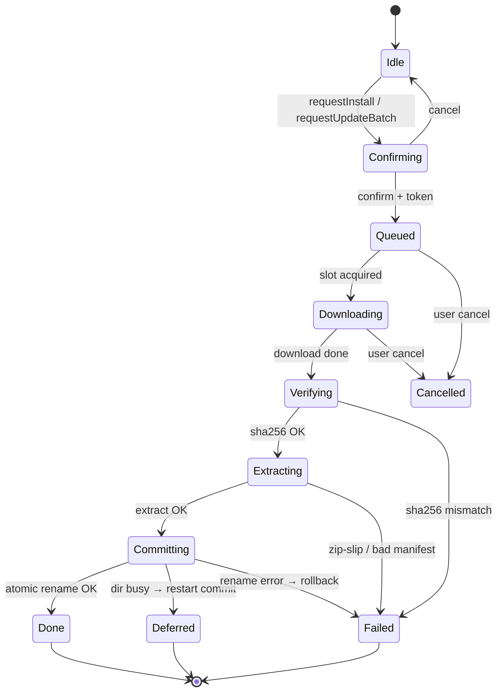

# 插件安装/更新确认 —— 壳托管与批量更新 · 待决策提案

> **状态：待决策**（2026-11-24 立案；用户当场指方向：确认 UI 收归壳、批量一次、修 Update 误跳详情）。
> **一句话**：把「每次更新弹一张确认卡」改成「**新装必问、同源更新批量一问、风险变更必问**」，并把确认 UI 与执行权收归壳——**任何市场想装/更新插件，都必须走壳的确认 API；原始安装 API 不再能被静默调用**。
> **原型**：[01-原型.html](./01-原型.html)（**v2**：可点，含全部场景、状态与逻辑说明；完成态＝轻 toast + 铃铛通知面板；直接双击浏览器打开）。
> **关联**：[插件权限系统](../插件权限系统/00-提案.md)（长期权限面，别在本档重复）、[插件更新须重启](../插件更新须重启.md)（重启语义）。

---

> **拍板记录（2026-11-24）**：**D2 = 一次性 token 强制**；**D5 = 两条独立开关 + 来源信任清单**；**D8 = 可替换渲染槽 + 默认壳渲染器**；**D7 = P0 市场先行、P1 全套**；**D9 = P1 一并加 check-feature-folder（白名单例外）**；**P1 插件 = marketplace + lang-defaults；settings 仅在新增一次性 HostSettingSlot 时发 1.0.49（普通配置不发）**；**作者文档中英双语全更**；**P0 现在开工**。D1/D3/D4/D6 按推荐执行。

---

## 〇、决策区（请先拍板）

| # | 决策 | 选项 | 我的建议 |
|:--|:--|:--|:--|
| **D1** | 确认 UI 归谁 | A 市场自绘（现状）／B 壳托管、壳绘制／C 壳托管＋市场只能追加「纯文本说明」 | **C**：UI 与安全语义归壳，市场只提供结构化数据（名称/版本/来源/发布者/changelog 链接），⛔ 不传 HTML/CSS |
| **D2** | 怎么让「必须调 API」真的成立 | A 只写契约要求市场调用（可绕过，不成立）／B **原始 `pluginManager.install/update` 收为内部，改为一次性确认令牌**／C 保留原始 API 只记警告（过渡） | ✅ **2026-11-24 拍板 B**：壳的确认流程发放一次性 token（绑定 pluginId + version + source + sha256 + 过期时间），没有 token 的 install/update 一律拒绝 |
| **D3** | 同源更新还逐项弹吗 | A 每次弹（现状）／B **同源更新不逐项弹；批量只弹一张汇总卡**／C 完全静默（连首装也不问） | **B**；C 不建议（等于把安装信任一次性全交出去） |
| **D4** | 批量怎么跑 | A 逐项 `await`＋每项确认（现状）／B **一张汇总确认 → 全部入队 → 壳的 3 并发槽执行 → 统一进度/汇总** | **B**：3 是下载/解压并发，不是条数上限 |
| **D5** | 设置形态 | A 单选三档（第一版原型，❌ 官方与信任来源不能同时免问）／B **两条独立开关 + 按来源信任清单**：① 官方目录更新不询问 ② 信任来源的更新不询问；两者可同时开；首装/来源变更不可关 | ✅ **2026-11-24 拍板 B**：开关正交，别用互斥单选 |
| **D6** | 市场自己（core）要不要进 Update all | A **不进批量，单更＋重启提示**／B 进批量 | **A**：自更新要重启，混在批量里会打断队列 |
| **D7** | 落地顺序 | A **P0 市场侧：批量一张卡＋修误跳＋不跳详情；P1 壳托管＋HTTPS/sha256/来源身份**／B 一次到位（壳不发版，周期长） | ✅ **2026-11-24 拍板 A**：先把体感修好，同时把真安全排进 P1 |
| **D8** | 确认 UI 与「表现层可替换化」 | A 壳写死一套确认 UI／B **确认 UI = 可替换渲染槽（默认壳渲染器，第三方可整套替换；逻辑/token 仍在壳）** | ✅ **2026-11-24 拍板 B**：符合 04《万物皆可插件·表现层可替换化》§3.2；默认渲染器也走 `@linkdesk/ui` 共享件 |
| **D9** | 文件落点 / 禁止平铺 | A 继续在 `services/` 平铺加文件／B **壳内专建安装更新功能夹（feature-folder + 门面）＋机械门禁** | ✅ **2026-11-24 拍板 B（P1 一并加）**：`check-feature-folder` + 白名单例外（存量 `App/` 平铺是拍板保留的） |

> 🔴 **D2 是关键**：只要求市场「调用新 API」而不关闭原始安装通道，等于没做——任何插件仍然能直接调壳 API 静默安装。必须让**壳的原始安装/更新入口本身**变成「无确认令牌不可执行」。

---

## 一、问题与现状

### 1.1 用户实机痛点（2026-11-24）

1. **每次更新都要点一次确认**：`Update all` 存在，但实际是「N 个插件 = N 张确认卡」，点着点着就烦；
2. **体感有「一次只能更新 3 个」的上限**；
3. **点 Update 偶尔跳到详情页**，尤其在列表滚到最顶、首行卡片 hover 展开时；
4. **更新完不想再看到那个「更新页面/详情页」**——更新就更新，用户想进去看再自己点。

### 1.2 代码现状（读代码定位）

| 位置 | 现状 |
|:--|:--|
| `marketplace/src/services/installGate.ts` | **恒弹确认卡**；官方不豁免、来源不记忆；富卡走 `dialog.confirmContent`，缺面回落纯文字 confirm，再缺面返回 `false`（问不了就不装） |
| `marketplace/src/services/marketUpdateAction.ts` | 单项更新序列：在线防御 → 下载址 → `minAppVersion` 门 → **确认卡** → `pluginManager.update` |
| `marketplace/src/services/libraryActions.ts` | `updateAll` 是**串行 `await`**，逐个 `performMarketUpdate` ⇒ 逐个弹卡；`!r.core` 排除内置件 |
| `src/pluginLoader/lifecycle/install-queue/types.ts` | `INSTALL_CONCURRENCY = 3`——**下载/解压并发槽**，注释写明「先按 3 做、可校准、首批实机后由用户拍板」 |
| `src/pluginLoader/lifecycle/update.ts` | stage → unload → 原子 commit → 账本 → 重载；失败回滚/启动补提交；**无签名、无 checksum** |
| `src/core/services/plugins/IpcBridgeHandler/pluginManager.ts` | `install`/`update` 是**任何插件都能调的 IPC 面**——这是「市场确认门可被绕过」的根 |

### 1.3 历史复盘：为什么当年「每次都问」、为什么有 3

- **E6#71k（2026-09-10）**：用户先指出「装 7 个插件就是点 14 次按钮」，AI 提「每个来源第一次确认」并获同意；**当天用户改口**：「暂时都问吧……这个作为一个更新点，等未来版本专门研究安全问题，先不在这个地方纠结了」⇒ 信任表 `installTrust.ts` 整套删除，改成恒弹。**这是临时停损，不是终态。**
- **「3」的来历**：18 档 §八⑦c「先按 3 做」；同时实测「连点 7 个确认卡只能装上 0～1 个」——**确认卡不能排队**。所以「一次只能几个」的体感，主要来自确认卡阻塞，不是批量条数限制。
- **诚实边界**（`installGate.ts` 原话）：确认门只在市场 UI 层，不是安全机制；已装插件可绕开它直接调壳 API；全仓零签名/零 checksum。

---

## 二、目标与非目标

**目标**
1. 新装永远有一次明确的「来源/发布者/版本」确认；
2. 同源更新不再逐项打断；批量更新一次确认、连续执行、可见进度；
3. 点击 Update 不再跳详情页；更新完成也不自动开详情；
4. 把确认 UI 与执行权收归壳，任何市场都必须走同一条安全通道；
5. 为真正的安全（HTTPS、sha256、来源身份）留出壳侧落点。

**非目标**
- 插件权限系统/沙箱/签名（见 [插件权限系统](../插件权限系统/00-提案.md)，本档只引用，不重复设计）；
- 重做商店视觉/卡片布局；
- 自动更新的策略大改（只补「官方源优先」边界）。

---

## 三、架构：壳托管确认（D1 + D2）

### 3.1 为什么「市场必须调 API」本身不够

现在的 `pluginManager.install/update` 是公开 IPC 面。一个恶意/偷懒的市场可以完全跳过自己的确认 UI，直接调壳 API。**只加一个「新 API」而不收回旧通道 = 新 API 只是建议。**

⇒ 正确形态：**壳把「确认」变成执行的前置条件**，而不是市场的一个可选 UI。

### 3.2 目标 API（壳面）

```ts
// 壳暴露：所有市场（官方/第三方）共用；UI 由壳绘制
interface PluginInstallRequest {
  mode: "install" | "update";
  pluginId: string;
  version: string;
  downloadUrl: string;
  sha256?: string;              // P1 起必填（目录已收录的版本）
  source: {                     // 来源身份（壳记录/比对）
    id: string;                 // 市场源 id / official
    url: string;                // 目录源 URL
    repo?: string;              // GitHub repo（若可判定）
    publisher?: string;         // 作者/发布者
  };
  display: {                    // 只允许结构化纯数据，⛔ HTML
    name: string;
    icon?: string;
    description?: string;       // 纯文本，截断
    changelogUrl?: string;
    size?: number;
  };
}

interface PluginInstallResult {
  confirmed: boolean;
  cancelled?: boolean;
  jobId?: string;               // 确认后壳已入队；进度走 plugin:installJobs
  reason?: "user-cancelled" | "source-changed" | "integrity-failed" | "min-app" | "no-token";
}

// 唯一入口：确认 + 执行（壳内部同一事务）
linkdesk.plugins.requestInstall(req: PluginInstallRequest): Promise<PluginInstallResult>;

// 批量：一张汇总确认 → 逐项入队
linkdesk.plugins.requestUpdateBatch(reqs: PluginInstallRequest[]): Promise<{ confirmed: boolean; jobIds: string[] }>;
```

**原始通道的处理（D2）**
- `pluginManager.install/update` 改为**内部/受保护**：必须携带 `confirmationToken`（壳在确认流程里签发，一次性、绑定 `pluginId+version+source+sha256+expiresAt`）；
- 没有 token ⇒ 拒绝并记录 `install:rejected no-token`；
- 旧市场/旧插件在过渡期：新壳返回明确错误码 + 文档；**壳未发版，正好一次切换**；
- 第三方市场：调同一个 `requestInstall` 即可，能力不受限（壳 UI 统一，市场仍可自定义浏览面）。

### 3.3 壳绘制的确认卡（D1）

**壳拥有**：标题/按钮/焦点锁/Esc/遮罩/来源与发布者/版本/大小/风险徽标/哈希校验状态/「首次安装」「来源变更」「降级」等风险文案。
**市场只能给**：结构化 `display`（名称、图标、纯文本简介、changelog 链接、大小）。
**主题**：壳读当前主题 token（暗/亮/玻璃都成立），⛔ 不由市场传 CSS；需要品牌色时只接受一个 `accent` 色值并做对比度校验。

### 3.4 来源身份与信任（D5）

壳在安装账本里记录：`pluginId / sourceId / sourceUrl / repo / publisher / version / sha256 / installedAt`。

- **首次安装**：无论来源，必弹确认；
- **同源更新**（sourceUrl + repo + publisher + pluginId 全同、HTTPS、版本↑、sha256 命中）：按设置决定是否逐项确认；
- **来源/发布者变更**：按「新装」确认，卡片明确展示 `旧源 → 新源`；
- **降级/选旧版**：确认；
- **完整性失败 / id 不符 / minApp 不满足**：直接拒绝，不弹。

### 3.5 设置（D5）——两条独立开关 + 来源信任清单

**不用互斥单选。** 两个正交开关，可同时开：

| 键 | 类型 | 默认 | 含义 |
|:--|:--|:--:|:--|
| `app.pluginUpdate.silentOfficial` | boolean | 开 | 官方目录的**同源更新**不逐项询问 |
| `app.pluginUpdate.silentTrustedSources` | boolean | 关 | 用户显式信任过的第三方来源，其**同源更新**不逐项询问 |

以下**不可关**（只读展示，写死为真）：首次安装始终确认；来源/仓库/发布者变更始终确认；降级/哈希不符始终拦截或确认。

**来源信任清单**（每行显式状态，别让用户猜「点一下是信任还是不信任」）：

| 来源 | 地址 | 信任 | 覆盖范围 |
|:--|:--|:--:|:--|
| Official catalog | github.com/Encaron/linkdesk-marketplace | 开（固定） | 同源更新；首装仍确认；来源变更自动失效 |
| 第三方示例源 | example.dev/source | 关 | 打开后：同源更新免问；首装仍确认；来源变更自动失效 |

**落点**：`src/App/config/update.ts` 已经在「通用」组注册了「更新」节（`app.update.mode` / `app.update.showReleaseNotes`）；新增 `src/App/config/pluginUpdate.ts`，`group: t("插件更新")`，在 `registerUpdateConfiguration(t)` 之后注册。设置页本身是普通插件、可整套替换；新键是**配置声明**，任何设置插件都应渲染；信任清单用共享件 + `uiHint`（见 §3.7）。

> 你说的「以后从插件市场下载都不需要点确认」= 上述两个开关对**更新**的效果；**首装不建议静默**——那等于把第一次信任决定也省掉。

### 3.6 与真实实现对账（2026-11-24，原型第一版纠偏）

| 面 | 真实实现 | 第一版原型的问题 | 本版修正 |
|:--|:--|:--|:--|
| 完成反馈 | 轻 Toast（`TransientToast`，底部居中）＋ 铃铛通知面板（`ldk-status-bar-notif-panel`）——**同一通知 store 双呈现** | 我编了一个全屏「完成页」＋打勾 | **删掉整页**；完成 = 轻 toast 即时汇总 ＋ 铃铛面板留结果/重试；⛔ 不新开页面、不弹新模态、不造第三面 |
| 设置落点 | 「通用」组内「更新」节（`src/App/config/update.ts`） | 独立设置页，且用互斥单选 | 改为真实设置页：左侧组导航 + 右侧「通用」；「更新」节后新增「插件更新」节；两条独立 `Toggle` |
| 共享件 | `@linkdesk/ui` 有 `Toggle` / `Button` / `Badge` / `FormRow` / `ContextMenu` 等 | 自绘开关、自绘行 | 全部用共享件口径；不造第二套 |
| 更新进度 | 壳侧 job 表 → 通知面板每行进度 | 自造右下进度坞，与真实通知面割裂 | 进度/结果都进**同一个通知面板** |
| 批量上限 | `INSTALL_CONCURRENCY = 3`（下载/解压并发，非条数） | 只画 4 行，没考虑混合来源/20+ | 混合来源分组 + 只列需确认项 + 20+ 滚动（§五·补） |

### 3.7 表现层可替换化合规（04《万物皆可插件》）

确认/批量 UI **是表现层**，必须可替换；但**确认判定、来源身份、token、队列、落盘**是壳逻辑，不可替换。落法：

1. **确认 UI = 渲染槽**（对齐 04 §3.2 `dialogChrome` / renderer slot）：壳提供默认渲染器（`@linkdesk/ui` 的 `PluginInstallConfirm` / `PluginUpdateBatchSummary`），第三方插件可整套替换；替换体只吃 `InstallRequest` + `ConfirmPlan` DTO，⛔ 不碰 token/策略。
2. **通知面唯一，双呈现**：轻 Toast（`TransientToast`，底部居中）与铃铛通知面板（`ldk-status-bar-notif-panel`）是**同一通知 store 的两套呈现**（2026-11-19 授权恢复轻 Toast；⛔ 第二 store／⛔ 层外自绘）。完成态复用二者：轻 toast 做即时汇总，铃铛面板留结果与重试；⛔ 不另造第三面。
3. **设置页**是普通设置插件（可整套替换）；新「插件更新」节是配置声明，任何设置插件都要渲染；来源信任清单用共享件或 `uiHint`，不让官方设置插件私有实现。
4. **数据同源**：来源清单/信任状态/策略/批量计划全部走壳只读命令；渲染体只画。
5. **兜底**：渲染槽缺席/崩溃 → 壳默认渲染器；默认渲染器也崩 → 壳纯文字 confirm（现有降级梯）。
6. **共享件纪律**：默认渲染器只用 `@linkdesk/ui` 与自有组件，⛔ import 壳内部；R6/G1 门禁直接适用。行内「更多」动作/批量选择走共享 `ContextMenu`（已有多选能力），⛔ 自造第二套菜单；若自绘必须遵守 token 与 CSS 命名空间九件套。

### 3.8 归一化：同一事实一处来源（头像教训）

**历史证据（marketplace 自己的账）**：`eb0513f`（1.4.5「**头像三处统一取源**」）、`817ec72`（1.4.6「**三处身份同源**」）——此前作者头像/身份图在列表、详情、作者坞**各取一份**，改一处另两处不动。根因不是漏改，是**同一个事实有多个推导点**。

本功能新增的设置、确认、批量、通知四个面都涉及「插件身份 / 作者 / 来源 / 信任」——⛔ 不允许各面各推导一次。单一来源表：

| 事实 | 唯一来源 | 所有消费方 |
|:--|:--|:--|
| 插件身份图 | `pickIdentityArt` + `PluginIcon`（`@linkdesk/ui`） | 市场卡、详情、设置信任清单、确认卡、通知行 |
| 作者头像/主色 | `avatarCache` / `githubAvatarOf` / `avatarHue` | 同上 |
| 作者显示名 | **一个** `authorLabel`（现状 `catalogText.ts` 与 `installConfirmPayload.ts` 两份逐字节相同——P1 合并到共享件） | 卡、详情、确认卡、设置 |
| 来源身份 | 壳账本 `SourceIdentity`（sourceUrl/repo/publisher） | 设置、确认、批量、通知 |
| 信任状态 | 壳 `trust.ts`（唯一 store） | 设置信任清单、确认判定、批量计划 |
| 批量计划 | 壳 `policy.ts` 的 `ConfirmPlan` | 确认卡、执行、完成通知 |
| 文案 | i18n key | 所有面 |

**门禁**：P1 新增 `audit:duplicate-facts`（或并入 `check-single-implementation`）：禁止新增第二份 `authorLabel` / `repoHomeUrl` / source label / identity art 推导；命中即红。

### 3.9 设置页扩展：槽位，不是「每加一个设置就发设置插件」

**现状（代码实证）**：设置页是普通插件、可整套替换；`src/views/SettingsView/renderControl.tsx` 按 `uiHint` / `renderHint` 分发，**不认识的 `uiHint` 落到 `UnknownHintControl`（只读 + 说明）**。⇒ 直接新增一个 `uiHint`（如 `sourceTrust`）**必然要改设置插件**——这正是「为什么设置要发版」的根因。

**修法（P1，一次性）**：

1. 在设置插件加**一次**通用 `HostSettingSlot`（`renderHint: "hostSlot"` + `slotId`），由壳注册渲染器；`@linkdesk/ui` 提供 `HostSettingSlot`。
2. 之后任何宿主新增设置（含插件更新信任清单）只需「配置声明 + slot 注册」，**零设置插件发版**。
3. 普通配置项（boolean / enum / number / string）本来就不需要设置插件发版——本功能的两条 Toggle 就是纯配置，settings 不动。
4. 若这一轮连「一次设置发版」都不要：信任清单改用普通配置行（`stringList` / 只读列表），但无法逐源开关、体验差；或把信任清单后置。**推荐一次性槽位**——一次换长期零发版。

---

## 四、确认策略矩阵（最终版）

| 动作 | 确认？ | 形态 |
|:--|:--:|:--|
| 新装插件（任何来源） | **是** | 壳富卡（来源/发布者/版本/大小/哈希） |
| 同源更新 · 官方（`silentOfficial` 开） | **否** | 直接入队，通知面板行内进度 |
| 同源更新 · 第三方（`silentTrustedSources` 开且来源已信任） | **否** | 直接入队；信任状态在设置里显式可见 |
| 同源更新 · 第三方（未信任） | **是** | 一张确认卡；确认后记住与否由用户勾选 |
| 批量 Update all · 混合来源 | **只对 ask 项** | 一张汇总卡只列需确认项；silent 项以摘要行显示；取消 = 整批取消 |
| 来源/仓库/发布者变更 | **是** | 「来源变更」卡（旧→新）；不受信任开关豁免 |
| 降级/选旧版 | **是** | 确认卡（已有语义） |
| minAppVersion 不满足 | **否（直接拦）** | 错误提示，不进入确认 |
| 哈希/ID/zip-slip 失败 | **否（直接拒）** | 错误 + 清理暂存 |
| 自动更新（opt-in） | **否** | 结束后汇总通知；默认只对官方源开 |
| 完成反馈 | **不新开页面/不弹新模态** | 轻 Toast（`TransientToast`）即时汇总 + 铃铛通知面板留结果/重试（同一 store 双呈现） |
| 内置 core（市场自身） | **单更** | 单项确认（若策略要求）→ 更新 → 重启提示；不进批量 |

---

## 五、批量更新（D4）

1. 市场调 `requestUpdateBatch(entries)`——只传结构化请求；**市场不判定谁要确认**，也不做批量计划。
2. 壳 `policy.ts` 计算 `ConfirmPlan`：`silent[]` / `ask[]` / `groups[]`（按来源分组）。
3. `ask` 为空 ⇒ **不弹卡**，全部直接入队；`ask` 非空 ⇒ 只列 `ask` 项，`silent` 项用摘要行显示（「官方 3 个将直接更新」）。
4. 确认 = `ask + silent` 全部入队；**取消 = 整批取消**（避免「只跑了一半」的惊喜）。
5. 进度与结果 = **轻 Toast（即时汇总）＋ 铃铛通知面板（持久结果/重试）**——两者是同一通知 store 的双呈现（`TransientToast` / `ldk-status-bar-notif-panel`）；进行中/等待中/已完成三段；失败行留 [重试]；不新开完成页、不弹新模态、不造第三面。
6. 不逐项弹卡、不自动开详情页；`Update all` 不含 core（市场自身单更后提示重启）。

### 5.1 混合来源规则（必须由壳算）

| 场景 | 弹窗显示 | 执行 |
|:--|:--|:--|
| 官方 3 个（silentOfficial 开）+ 第三方 2 个（未信任） | 只列第三方 2 行；摘要「官方 3 个将直接更新」 | 确认后 5 个全部入队；取消 = 0 个 |
| 官方 3 个（silentOfficial 开）+ 第三方 1 个（已信任，silentTrustedSources 开） | **不弹窗** | 4 个全部直接入队 |
| 官方 3 个（silentOfficial 关）+ 第三方 2 个（未信任） | 列全部 5 行，按来源分组 | 确认后 5 个全部入队 |
| 在弹窗里勾上「以后官方源更新不再询问」 | 官方行立刻移出列表，只剩第三方 | 若 `ask` 归零 ⇒ 自动关卡并开跑 |

- 每行 checkbox 默认全选；取消勾选 = **只从本批排除**，不改信任设置。
- 分组头显示来源、数量、信任状态（「信任中 · 同源更新免问」/「未信任 · 本次需确认」）。
- 排序：需要确认的组在前，免问组在后；组内保持目录顺序（不跳位）。

### 5.2 20+ 条溢出

- 弹窗正文是**滚动区**（`max-height`），表头/底栏 sticky；不把弹窗撑破。
- 分组计数 + 顶部总览：「共 24 个 · 3 个需确认 · 21 个免问」。
- 20 条用普通列表即可；超过 50 条再上虚拟化（同一 `ConfirmPlan` 数据，不改协议）。
- 不允许「全展开成一张长表」——这会把 24 行塞进一个不可滚的弹窗，正是第一版只画 4 行掩盖的问题。

---

## 六、Update 按钮误跳详情页（P0 必修）

### 6.1 根因

`CardGrid` 的展开面用 `useStickyClearance` 算吸顶避让量 `--x-shift`：
- `onPointerEnter` 量一次（此时 `0fr → 1fr` 动画刚开始，`scrollHeight` 可能还是 0/半截）；
- 按钮获得焦点（mousedown）时 `onFocus` **再量一次**（此时展开已生效，按完整高度算）⇒ `--x-shift` 变大，整个展开面（含 Update 按钮）向下跳，最多 `HOVER_MAX_SHIFT = 80px`；
- 鼠标没动，按钮从指针下跑掉；mouseup 落在卡片本体 ⇒ 触发整卡 `onClick` = 打开详情页。`ActionButton` 的 `stopPropagation` 只在「按钮是事件目标」时有效，目标已变成卡片，拦不住；
- 对话框抢焦点触发 `onBlur` 复位，还会再跳一次。

### 6.2 修法（几何契约，不是调数值）

1. **hover 会话内冻结几何**：`pointerenter` 时按「完全展开」的确定性高度算一次 `--x-shift`，之后 `focus/blur` 不再重算；
2. **只在指针不在卡内时响应键盘 focus**；`onBlur` 不因对话框抢焦点而复位，**`pointerleave` 才复位**；
3. **测量确定性**：展开高度不读动画中的 `scrollHeight`——用隐藏测量/固定内容高度/一次强制展开测量，保证两拍同值；
4. **防御性抑制**：动作区 `pointerdown` 记「刚点过动作」，短时间内卡片 `open` 不响应（双保险）；
5. **回归**：`hoverShift` 纯函数单测 + 模拟 rect 的 hook 测试（focus 前后 `--x-shift` 不变）+ 真机顶行步骤。

### 6.3 验收

滚到最顶 → hover 首行卡 → 点 Update：**按钮不动**、确认卡/进度正常；取消后卡片不位移；只有点卡片空白才进详情；更新完成不自动开详情。

---

## 七、安全硬化（P1，命根子）

> 弹窗只负责「让你知道装的是什么」，不负责「拦住坏东西」。真正的安全必须在壳。

| 项 | 现状 | P1 目标 |
|:--|:--|:--|
| 传输 | `http(s)` 都允许 | **远程强制 HTTPS**；http 源拒绝（磁盘路径除外） |
| 内容完整性 | 无 checksum | 目录 `versions[]` 增 `sha256`；壳下载后**先校验再解压/commit**；不符 → 删除暂存 + 拒绝 |
| 来源身份 | 只记 `user/marketplace` | 账本记录 `sourceUrl/repo/publisher`；变更 → 重新确认 |
| 降级 | `allowOlder` 显式放行 | 保留 + 确认卡明示 |
| 原子替换 | 已有 stage/commit/回滚 | 保留；P1 不动 |
| 自动更新 | opt-in | 默认仅官方源；第三方源需显式打开 |
| 签名/权限 | 无 | 长期：接 [插件权限系统](../插件权限系统/00-提案.md)；签名另立 |

**迁移**：旧目录条目没有 `sha256` ⇒ 过渡期「未校验」徽标 + 不阻断；官方目录回填后，新版本强制校验。`sha256` 由 publish 计算，SDK/kit schema 同步。

---

## 八、接口与状态机



**事件**：沿用 `plugin:installJobs` 全量快照（壳侧唯一生产），市场只读渲染；`requestInstall` 返回 `jobId`，进度/终态从 job 表读。

**token 形状（D2）**

```ts
interface InstallConfirmationToken {
  token: string;          // 一次性 nonce（壳签名/内存表）
  pluginId: string;
  version: string;
  sourceUrl: string;
  sha256?: string;
  expiresAt: number;      // 60s
  used: boolean;
}
```

壳在 `requestInstall` 内完成「画卡 → 用户确认 → 签发 token → 立刻执行」；原始 `install/update` 只接受未使用的 token，用完即焚。

---

## 九、影响面与实施顺序

### P0（先做，市场插件可自主发版；壳不用发）

- 修第六节误跳 bug；
- `Update all` 改**一张汇总卡**（只做 UI 合并，**⛔ 不在市场里做来源信任/免问判定**）→ 全部入队/进度；
- 更新后不跳详情；完成态用现有通知面板，不新增页面；
- 市场版本 1.4.25；壳侧只需已有的 job 队列/并发槽。

> P0 是**过渡桥**：市场仍然「每次都问」，只是从 N 张卡变成 1 张卡；来源信任/免问全部留给 P1 壳。避免在市场里长出第二套策略逻辑。

### P1（壳托管 + 真安全；壳 0.2.6x 攒批，等用户发版）

- 壳新增 `plugins.requestInstall/requestUpdateBatch` + 壳侧 `policy/trust/token/batch` 功能夹（§9.5）；
- 确认 UI 改为**可替换渲染槽**（默认壳渲染器，第三方可整套替换；逻辑/token 在壳）；
- 原始 `install/update` 收为 token 保护；
- 来源账本 + 来源/发布者变更检测；
- HTTPS-only + 目录 `sha256` + 壳校验；
- 设置：`app.pluginUpdate.silentOfficial` / `app.pluginUpdate.silentTrustedSources` + 来源信任清单（§3.5）；
- 市场删除自己的 `installGate`（保留旧壳兼容回落）。

### P2（长期）

- 权限系统（引用 `插件权限系统`）、签名、沙箱；不在本档展开。

### 9.5 壳侧落点与目录（D9）

```
src/core/services/plugins/install/     ← 新功能域（feature-folder，⛔ 不往 services/ 根平铺）
  index.ts            // 门面：requestInstall / requestUpdateBatch / ConfirmPlan（唯一公开入口）
  types.ts            // InstallRequest / ConfirmPlan / InstallConfirmationToken
  policy.ts           // 谁需要确认：silent/ask 分组（纯函数，可单测）
  trust.ts            // 来源信任清单（配置读写 + 失效规则）
  token.ts            // 一次性 token 签发/核销
  batch.ts            // 批量编排、分组计数、溢出策略
  ledger.ts           // 来源身份记录（sourceUrl/repo/publisher/sha256）
  confirm-service.ts  // 壳 DialogHost 编排：画卡 → 确认 → 签 token → 执行
  __tests__/          // 与各子模块同层；禁止测试平铺到 services/ 根
src/pool/shared/plugin-install-confirm/ ← 默认渲染器（表现层；可被 renderer slot 替换）
  InstallConfirmView.tsx
  BatchConfirmView.tsx
src/App/config/pluginUpdate.ts          // 「通用 → 插件更新」配置节（独立 Toggle + 信任清单 uiHint）
```

> 🔴 **现状差异（先报差）**：`scripts/check-*.mjs` 里**没有**「禁止平铺」的机械腿（我查了全部 `check-*`；壳目录规范只有 feature-folder 判据，`check-file-size` 只限单文件行数）。建议本笔新增 `check-feature-folder`：新功能域必须「同名夹 + 门面 index.ts」，白名单例外登记；否则红。⛔ 不靠 AI 自觉。

---

## 九·补、发版矩阵（2026-11-24 拍板后）

### P0（只发 marketplace 1.4.25；壳不发）

> **状态：2026-11-24 拍板「现在就做 P0」**。P0 只做市场侧 UI 合并 + 误跳修复，⛔ 不做来源信任/免问判定。

- **代码**：`updateAll` 改一张汇总卡（市场侧，**仍然每次问**，⛔ 不做来源信任/免问判定）；修 `useStickyClearance` 误跳详情；更新后不自动开详情；完成走现有轻 toast + 铃铛通知面板。
- **发布**：marketplace `build → publish → 1.4.25` → 官方目录收录 → `sync:bundled --latest`；CHANGELOG/README 同笔。
- **不动**：contracts / sdk / kit / ui / plugin-docs / settings / lang-defaults——P0 只是市场 UI 合并 + bug fix，不新增契约、不改壳、不增壳文案；市场自己的 en/zh 字典随包更新。
- **为什么**：先把「N 张卡 + 误跳详情」的体感修掉；不把来源信任逻辑塞进市场，等 P1 壳托管。

### P1（壳 dev + npm 五包 + 插件 + 文档 + 目录/种子）

| 轴 | 版本 / 动作 | 具体 |
|:--|:--|:--|
| 壳 | **0.2.6x 攒批（不发布）** | `plugins/install/` 功能夹（policy/trust/token/batch/ledger/confirm）、renderer 槽、设置「插件更新」节、通知双呈现接线、HTTPS-only + sha256 校验、来源身份账本 |
| `@linkdesk/contracts` | **0.1.53** | `plugins.requestInstall / requestUpdateBatch / getUpdatePolicy / setUpdatePolicy / trustSource / untrustSource` + `InstallConfirmationToken` 类型 |
| `@linkdesk/plugin-sdk` | **0.1.112** | 若 D8 走 `contributes.renderers`：renderer 贡献点 schema + lint；`publish` 写 `sha256` 到目录条目 |
| `@linkdesk/marketplace-kit` | **0.1.8** | `marketplace.json` 的 `versions[].sha256` schema / 类型 / 模板；validate 对账 |
| `@linkdesk/ui` | **0.2.76** | `PluginInstallConfirm` / `PluginUpdateBatchSummary` / `PluginSourceTrustList` 默认渲染件；复用 `Toggle`/`FormRow`/`ContextMenu`/`Badge` |
| `@linkdesk/plugin-docs` | **0.1.99** | 作者文档：确认策略、信任、批量、sha256、renderer 槽；中英双语；`docs:check` |
| **marketplace** | **1.4.26** | 切到壳 `requestInstall/requestUpdateBatch`，删除市场 `installGate`（保留旧壳回落）；P0 汇总卡保留 |
| **settings** | **1.0.49（仅一次性 HostSettingSlot）／否则 1.0.48 不动** | 普通配置项（两条 Toggle）由通用渲染器出，**不需要设置发版**；信任清单若要自定义行，加一次通用 slot，之后新设置零发版 |
| **lang-defaults** | **1.0.69** | 新确认/批量/信任/错误文案的中英 key；否则英文界面裸 key |
| **create-linkdesk-plugin** | 0.1.27（仅当模板改了才发） | 默认不动，⛔ 不无脑 bump |
| **官方目录** | 收录 marketplace 1.4.26 + `sha256` 回填 | 媒体保留 merge；旧条目无 hash → 过渡期「未校验」 |
| **出厂种子** | marketplace 1.4.26 | `sync:bundled --latest` |

**发布顺序**：contracts / sdk / kit / ui / plugin-docs（npm）→ marketplace / settings / lang-defaults（插件）→ 官方目录 → 出厂种子 → `release:mark`；壳 dev 先行、**不 tag 不发布**。

**作者文档落点**：`docs/03-plugin-authoring/`（英文）＋ `docs/03-插件制造/`（中文）；`plugin-docs` 生成物与双语门禁同笔。**其他官方插件不无脑 bump**——只有 manifest/设置/README 真被动过才发。

---

## 十、验收清单

- [ ] 新装：壳富卡必现；伪造插件直接调原始 `install` ⇒ 被拒（`no-token`）；
- [ ] `Update all`：一张汇总卡；混合来源只列 ask 项、silent 项摘要；取消 = 整批 0 个；确认 = 全部入队；
- [ ] 20+ 条：滚动区 + sticky 表头/底栏 + 分组计数；不撑破弹窗；
- [ ] 同源单项更新：官方/信任来源按两条独立开关免问；未信任第三方一问；无逐项弹卡；
- [ ] 设置：两条独立 `Toggle` 可同时开；来源信任清单每行显式「信任中/未信任」+ 覆盖范围；首装/来源变更不可关；
- [ ] 来源/发布者变更：出现「来源变更」卡；旧→新可见；信任开关不豁免；
- [ ] 降级：确认卡；minApp 不满足：直接拦；
- [ ] 哈希不符：拒绝 + 清理暂存 + 明确错误；
- [ ] Update 按钮：顶行 hover 点击不位移、不跳详情；更新完成不自动开详情；
- [ ] 完成态：轻 Toast（底部居中）做即时汇总 ＋ 铃铛面板（status-bar-notif-panel）留结果/重试；⛔ 无新完成页、无新模态、无第三通知面；
- [ ] 表现层替换：确认 UI 换成第三方渲染器后，token/策略/队列仍在壳；渲染器缺失/崩溃 → 默认渲染器兜底；
- [ ] 设置插件整套替换后，新「插件更新」节与信任清单仍能渲染（配置声明 + 共享件/uiHint）；
- [ ] 离线/磁盘满/目录占用/重启补提交：均有真话与恢复路径；
- [ ] core 自更新：单更 + 重启提示，不进批量；
- [ ] 目录：新功能域（`plugins/install/`、`plugin-install-confirm/`）落 feature-folder；`check-feature-folder` 门禁绿。

---

## 十一、风险与未决

1. **token 收口会破坏旧市场/旧插件**——壳未发版，正好一次切换；第三方市场需按新 API 适配（文档 + 错误码）。
2. **`sha256` 迁移**：旧条目无哈希；过渡期「未校验」徽标，官方目录回填后强制。
3. **渲染槽弹性**：第三方可换确认 UI，但 token/策略/队列必须在壳；渲染器缺席/崩溃 → 默认渲染器 → 纯文字 confirm 两级兜底。⛔ 不开放 HTML/CSS 注入。
4. **第三方设置插件**：新「插件更新」节是配置声明，任何设置插件都应渲染；信任清单若走共享件/uiHint，换设置插件不丢 UI；若某设置插件不认该 hint → 退回配置行 + 命令面（AI 仍可操作）。
5. **混合来源取消语义**：取消 = 整批取消（含 silent 项），避免「只跑一半」；若要「只更免问项」，另立命令，不在默认按钮上做二义。
6. **P0 过渡桥**：市场只做一张汇总卡，⛔ 不得把来源信任/免问策略写进市场；P1 壳就位后删除市场侧确认门。
7. **禁平铺门禁**：现状无机械腿；新增 `check-feature-folder` 必须带白名单例外（存量 `App/` 平铺是用户拍板保留的，⛔ 一刀切红）。
8. **core 自更新**：更新市场自身后 job 仍在跑；需要「先完成队列再重启」或单更后提示。
9. **自动更新**：默认官方源；第三方源静默更新需要用户显式信任，且来源变更自动失效。

---

## 附录：用户原话（2026-11-24）

> 「把它继续留在插件市场，第二个把它放到壳里面，让壳来绘制这个 UI。这样子不管是哪个插件市场放过来，都必须调用这个新的 API。不调用这个新的 API 就无法成为插件市场……首次安装点击确认这个东西必须，只要你想成为插件市场，你就必须调这个 API。」
>
> 「批量 update all……只谈一张总会卡……在 04 里面制作一个任务……把各个页面的 html 画出来，画在一个 html 里……整个逻辑性也要必须确保完整。」
>
> 「更新按钮误跳详情页……我同意你的修法。但是建议先把 HTML 画出来，让我看看效果对不对。」
