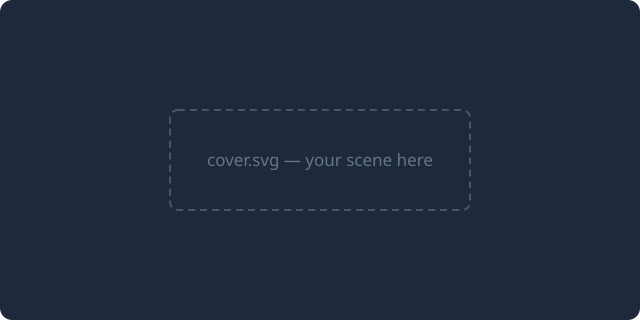

# {{displayName}}

> One line: what this plugin does. (Keep it at the very top — this file is what the marketplace shows on the **Details** tab.)

<!-- When you have cover art, put the image at resources/cover.svg and uncomment the line below:
 -->

## How to use

How to open it in LinkDesk, where to click, what you should see. Spell out the path a first-time user walks.

## Directory layout — where things go

You do not need to pre-create empty folders (git does not track them). **Create them when you need them; the table below says where.**

| Path | What goes here | When it exists |
|:--|:--|:--|
| `plugin.json` | The plugin manifest | **Always** |
| `README.md` | Description — the data source for the marketplace **Details** tab, and the GitHub landing page | **Required** |
| `docs/readme/<lang>.md` | Additional-language READMEs (e.g. `docs/readme/en.md`). Declare them in `plugin.json` `readme.locales`; shared images stay in `resources/` (reference them as `../../resources/...`). Do **not** create empty translations — add a file only when it has real content. | When you translate |
| `CHANGELOG.md` | Release notes — the data source for the marketplace **Changelog** tab | Strongly recommended |
| `resources/` | Assets — **three preset placeholders, each with a job comment inside**: `icon.svg` (small in-app icon) / `icon-bar.svg` (Icon Bar single-colour glyph) / `cover.svg` (README cover), plus any images referenced from the README | Always (replace the placeholders) |
| `i18n/` | `en.json` (key = the source string; **do not create `zh.json`**) | Once you have UI text |
| `themes/` · `languages/` · `snippets/` | Payloads for data-only plugins | Data-only plugins |
| `src/index.tsx` | Entry (the `entry` in `plugin.json`) — also calls `registerPluginCommands()` **at the top level** (entry command handlers must work viewless; the top-level side effect is the only registration moment) and registers the **view-level** command inside the component (needs this view) | Always for view plugins |
| `src/commands.ts` | Command samples — a runnable `hello` command (entry level) plus a **long-running** `longTask` sample (`meta.async`); every command declares the four contract fields (`activation` / `risk` / `returns` / `example`). Spec + checklist: author doc `21-command-ification-spec.md` | Add commands here |
| `src/views/` | Sidebar / panel view components (the files `contributes.views` points at) | Once you have views |
| `src/components/` | Components reused inside this plugin | When needed |
| `src/services/` | Domain logic / IPC wrappers / data layer | When needed |
| `src/styles/` | **Multiple** CSS files — keep them together here (a single file next to the entry is fine too) | When needed |
| `src/__tests__/` | Unit tests — **test tooling is preinstalled** (`vitest` / `jsdom` / `@testing-library/react` are already in `devDependencies`); the `window.linkdesk` mock is **not** in this repo — `vitest.setup.ts` is a one-line pointer to the shared ground in `@linkdesk/plugin-sdk`, so just write tests and run `npm run test` | When needed |

> 🔴 **Shared things do not belong here** — components/hooks reused across plugins come from `@linkdesk/ui` (the public package the shell provides; it is already declared in `package.json` as `"latest"`, which resolves to the shell's current version line when you install — pin it to a specific shell version if you need a floor). The shell supplies that one instance at runtime, so **do not import its css** and **do not write a second copy inside your plugin**. Only logic that belongs to this plugin stays local.
> 🔴 **README translations live under `docs/readme/` — never stack `README.<lang>.md` at the root.** Root `README.md` is the GitHub landing + fallback; every other language is one file under `docs/readme/`. All shared images stay in `resources/` (one copy); a localized README references them as `../../resources/...`. Declare the paths in `plugin.json` `readme.locales` (schema field available).
>
> 🔴 **Manifest display text is i18n content.** Every human-readable string in `plugin.json` (name/description, command titles/descriptions, menu labels, view titles, settings titles/descriptions) must be a key in each declared language dictionary. `npm run lint` now fails on a missing translation; if you do not want to translate, remove the language declaration instead of shipping half a translation.
>
> 🔴 **Assets always live in `resources/` — no loose images in the plugin root.** What gets into the install package is what is **referenced by the README** or **declared by `icon` / `marketIcon`**; the directory name itself has no magic.
> 🔴 **Every import from `@linkdesk/ui` sets your `minAppVersion` floor** — that field is the oldest shell your plugin can run on, **not the shell you happened to test with**. An export that does not exist in that shell means the plugin **fails to load as a whole**, not that one component is missing. Since the dependency is `"latest"`, the gate has to compute the real floor for you: after changing your imports, run `npm run lint` and put the value it reports into `plugin.json`'s `minAppVersion`. (The `latest` dependency is only safe because something recomputes the floor — that is the pair.) What ships in this template is already the floor for the imports this template makes.

## Three rules for this plugin

1. **Colors come from theme variables** — always `var(--xxx)` in CSS, **never a hard-coded hex**. Reason: LinkDesk supports full theme replacement, so a fixed color means your plugin does not follow the theme.
2. **UI text goes through `t()`** — `t("source string")`, with English in `i18n/en.json` and **no `zh.json`** (the source string is the key and is its own fallback). **Only add keys you actually read with `t()`** — an unread key is a dead key. Code identifiers (`src/index.tsx` and friends) are not copy — do not wrap them in `t()`.
3. **Plugin identity comes only from declared fields in `plugin.json`** — declare whatever capability you need (`contributes` / `tabBehavior` / `icon` …). **Never make other people guess what your plugin is from a directory name or file location.**

## The command contract — four fields on every command

Every entry under `contributes.commands[]` declares:

| Field | Meaning | Example |
|:--|:--|:--|
| `activation` | `entry` (handler registered at module top level — callable with no view) or `view` (registered inside a mounted view — needs that view). The host records the runtime truth at registration; declare it so `describe` can tell the AI before the plugin is active. | `"entry"` |
| `risk` | **Required.** `R0` read-only / `R1` reversible write / `R2` side-effecting write / `R3` irreversible or physical (reset, continuous sending, interrupting a live connection). Missing ⇒ treated as R2. | `"R0"` |
| `returns` | Field table of the receipt (first-level keys). `[]` when the command returns nothing. | `[{ "name": "message", "type": "string" }]` |
| `example` | One request body that can be executed as-is. `{}` when there are no parameters. | `{ "name": "LinkDesk" }` |

- **Where the handler goes**: entry commands → module top level (`src/commands.ts`, called from `src/index.tsx`); view commands → inside the view component (`src/index.tsx`).
- A view command called without its view yields `EVIEWREQUIRED` — the AI can predict this from `describe.activation`.
- **Device & events**: declare `deviceTransports` before using `linkdesk.device.*`; declare `events.publishes` / `events.subscribes` for `eventBus.publish` (undeclared id ⇒ `EEVENTUNDECLARED`; fire-and-forget, no queue).
- **Write commands**: return the **post-change state** (never just `{}`/`true`); declare `idempotencyKey` (`string`) to let the host replay a successful result on retry (`replayed: true`); return `ECONFLICT` (`details.stateVersion`) on version conflicts.
- **Long-running commands**: pass `{ async: true }` in the registration meta (`AsyncCommandMeta` from `@linkdesk/plugin-sdk/runtime`). The shell answers `{ pending, opId }` and tracks the op (`opStatus`, `EOPEXPIRED`) — never build your own state machine, and there is no `runAsync` API.
- Full spec + checklist: author doc `21-command-ification-spec.md`.

**Dev preview note:** the dev host (`npm run dev`) gives your view a **fixed-height root container** (`#ld-root`) — write `height: 100%` on your root element with confidence and it fills the preview. You never need ResizeObserver self-healing or a "just in case" fallback layer; if your panel still renders collapsed or transparent in the preview, report it — don't code around it.

## Publishing

```bash
npm run publish     # create the GitHub Release + upload the .linkdesk-plugin + update the catalog
```

The first publish needs a GitHub token (the command walks you through it once and stores it locally). To see what it would do without doing it: `npm run publish -- --dry-run`.

Publishing also requires this project to be **pushed to GitHub** (`publish` uses your project's `origin` to create the Release):

```bash
git remote add origin git@github.com:<you>/<repo>.git
git push -u origin main
```

> The scaffold already created this repository for you (`main` branch + one initial commit), so this step is only about wiring the remote.
> If you generated with `--no-git`, run `git init -b main` and commit first.
